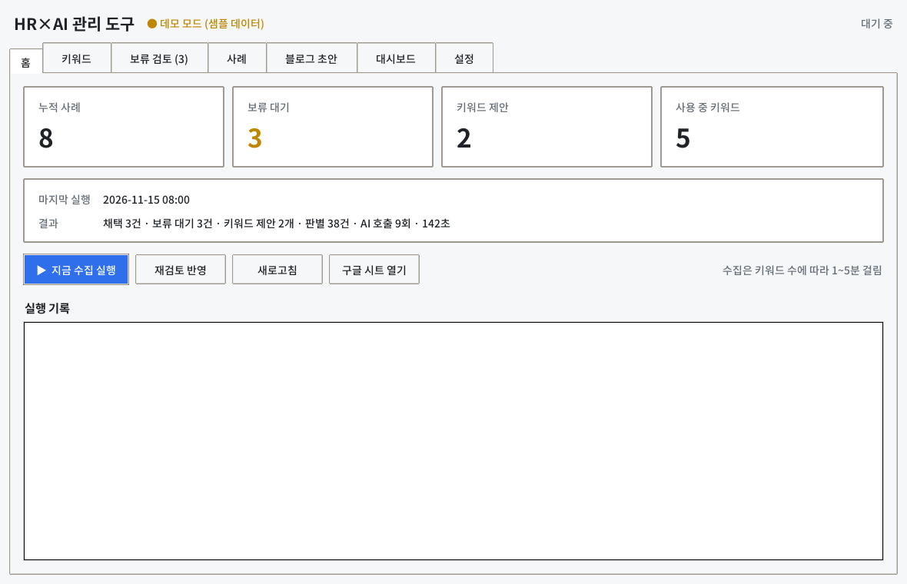
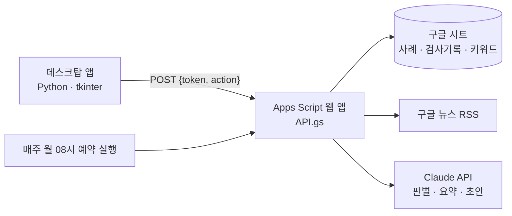
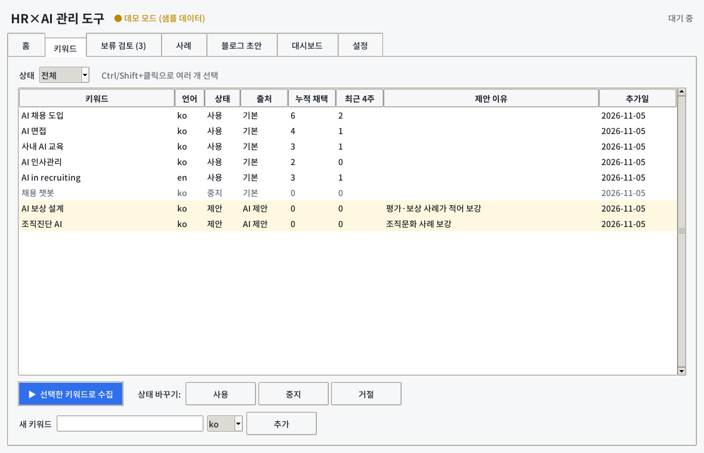
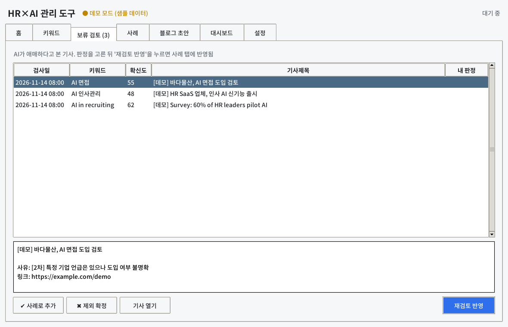
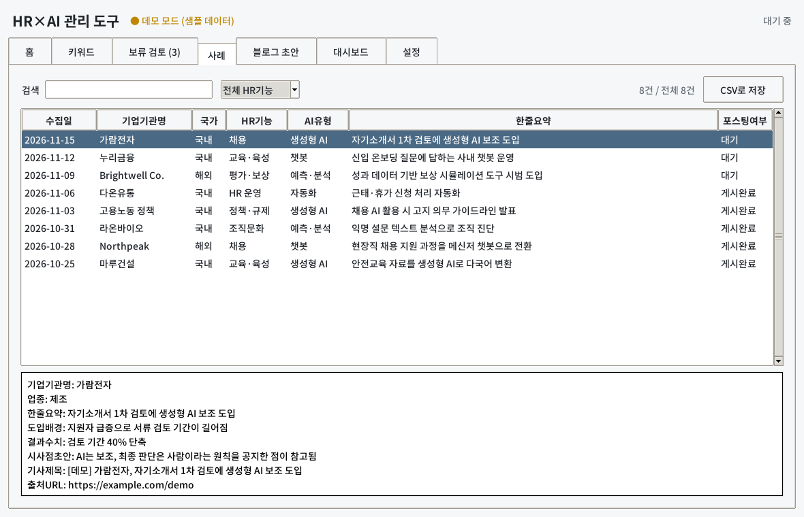
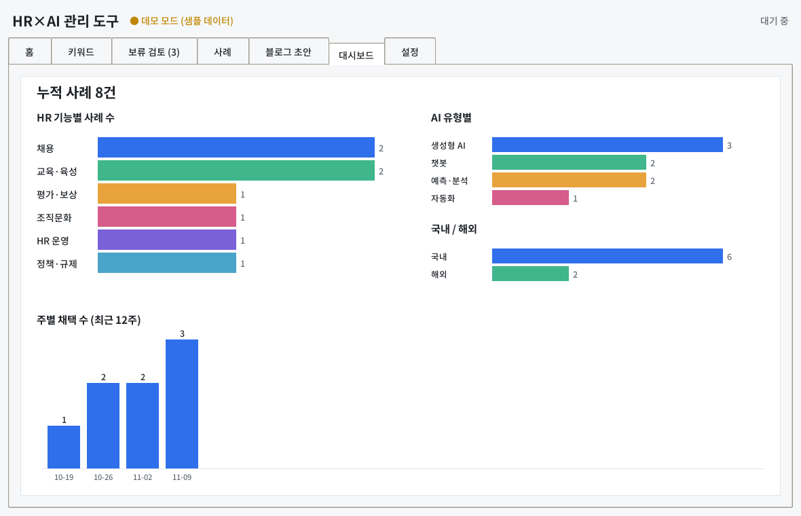

# HR×AI 관리 도구

구글 시트로 만든 **HR×AI 사례 수집 자동화**를 데스크탑 프로그램(exe)에서 운영하는 관리 도구입니다.

- 매주 구글 뉴스에서 HR×AI 기사를 모으고, Claude API로 사례 여부를 판별·요약해 시트에 쌓는 자동화(Apps Script)를 먼저 만들었습니다.
- 이 프로그램은 그 자동화를 웹 API로 열고, 시트를 직접 열지 않아도 수집 실행, 보류 검토, 키워드 관리, 초안 확인을 할 수 있게 만든 데스크탑 클라이언트입니다.

## 구조

| 구성 | 역할 |
|---|---|
| `apps_script/Code.gs` | 기존 자동화 본체(v4.6): 수집 → AI 판별 → 사례 저장 → 초안 생성 → 키워드 제안 |
| `apps_script/API.gs` | exe용 요청 창구(doPost). 토큰 확인 후 13개 요청 처리 |
| `app/main.py` | 데스크탑 화면 (홈, 키워드, 보류 검토, 사례, 초안, 대시보드, 설정) |
| `app/api.py` | 웹 앱 통신 + 연결 없이 시연하는 데모 모드 |
| `app/config.py` | URL·토큰을 PC 사용자 폴더에 저장 |

## 주요 기능

| 화면 | 할 수 있는 일 |
|---|---|
| 홈 | 누적 사례, 보류 대기, 키워드 제안 수 확인 / 지금 수집 실행 / 재검토 반영 |
| 키워드 | 상태(사용·제안·중지·거절) 변경, 새 키워드 추가, 고른 키워드로만 수집 |
| 보류 검토 | AI가 애매하다고 본 기사에 사람이 판정(사례로 추가·제외 확정) → 다음 판별의 예시로 학습 |
| 사례 | 검색, HR 기능별 필터, 상세 보기, CSV 저장(엑셀 호환) |
| 블로그 초안 | 주간 초안 확인, 복사, txt 저장 |
| 대시보드 | HR 기능별·AI 유형별·국내외 사례 수, 주별 채택 추이 |

## 설계에서 신경 쓴 점

- **로직은 한 곳에만**: 수집·판별 로직은 Apps Script에만 있고, exe는 요청만 보냄. 시트 메뉴로 돌리든 exe로 돌리든 결과가 같음
- **비밀값 분리**: Claude API 키는 Apps Script 스크립트 속성에만 있음. exe에는 키가 없고, 웹 앱 토큰은 처음 실행할 때 입력해 PC 사용자 폴더에만 저장함
- **동시 실행 방지**: 예약 실행과 수동 실행이 겹치지 않도록 실행 잠금(LockService)을 공유함
- **엇갈린 수정 방지**: 키워드 상태나 판정을 바꿀 때 행 번호와 내용(키워드·URL)이 둘 다 맞을 때만 반영함
- **데모 모드**: 실제 시트 없이 가상 샘플 데이터로 모든 화면을 시연할 수 있음 (샘플 기업명은 실제 기업이 아님)

## 실행

- exe: [Releases](../../releases) 또는 Actions 빌드 결과에서 `HRxAI-Manager.exe` 다운로드 → 실행 (처음엔 데모 모드)
- 소스: `pip install -r requirements.txt` → `python app/main.py`
- 직접 빌드: Windows에서 `build.bat` 더블클릭 → `dist/HRxAI-Manager.exe`
- 시트 연결 설정: `apps_script/API.gs` 맨 위 주석과 설치 가이드 참고

## 기술

Google Apps Script · Google Sheets · Claude API · Python 3.12 · tkinter · requests · PyInstaller · GitHub Actions

## 화면

| 키워드 | 보류 검토 |
|---|---|
|  |  |
| **사례** | **대시보드** |
|  |  |
